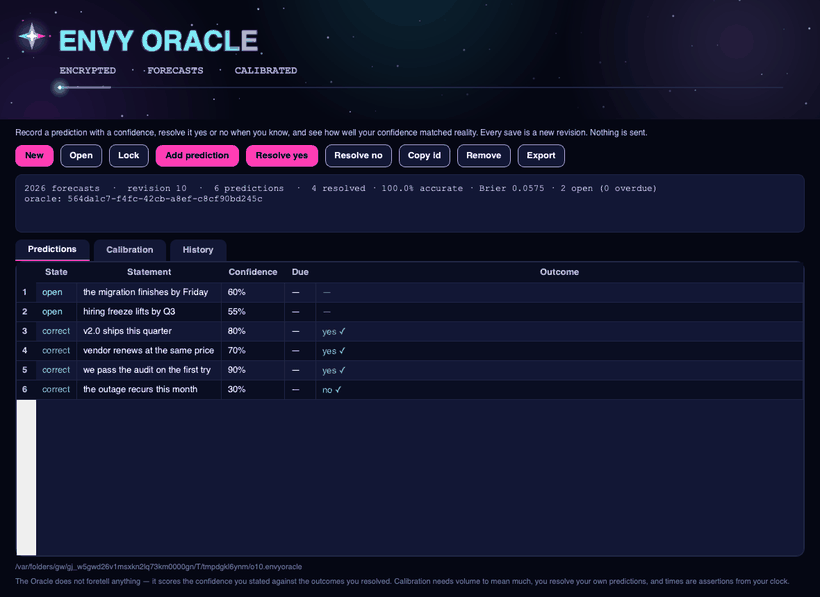
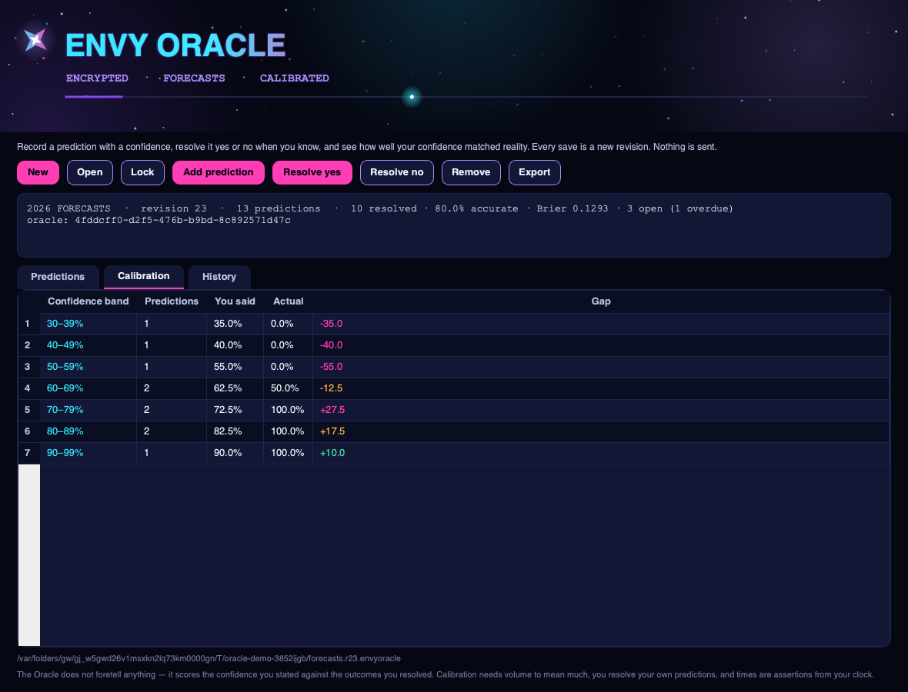

<p align="center">
  
</p>

<p align="center"><b>Record predictions with a stated confidence, resolve them yes or no when you know, and see how well your confidence actually matched reality — Brier score, accuracy and a calibration table — in a real native app window.</b><br />
AES-256-GCM encrypted oracles, a SHA-256 hash-chained event journal, revision-preserving saves, and plaintext export. From ENVY BLACK VEIL, as a standalone app.</p>

<p align="center">
  <a href="https://github.com/xzchick/envy-oracle/actions/workflows/tests.yml"></a>
</p>
<p align="center">
  
  
  <br />
  
  
  
  
</p>

<p align="center">
  <a href="#install"><b>Install</b></a> ·
  <a href="#works-on">Compatibility</a> ·
  <a href="#using-it">Using it</a> ·
  <a href="#honest-by-design">What it isn't</a> ·
  <a href="#build--test">Build</a>
</p>

<p align="center">
  
</p>

<p align="center"><sub>A real native window — not a browser view. The wordmark pulses, a four-point star turns in the header, and a light travels the accent bar.</sub></p>

<a name="features"></a>




Write down what you think will happen — "v2.0 ships this quarter", "this vendor renews at the same price" — each as a **prediction** with a **confidence** from 1 to 99 percent and an optional resolve-by date. When you know, **resolve** it yes or no. Oracle then measures how well your stated confidence matched reality: your **Brier score**, your **accuracy**, and a **calibration table** that groups your predictions by confidence band and shows, for each, how often things you were *that* sure of actually came true. The oracle is sealed in the same **AES-256-GCM** envelope [ENVY Vault](https://github.com/xzchick/envy-vault) uses.

<p align="center">
  
</p>

Good calibration means your 70%s come true about 70 percent of the time — the **gap** column shows where you run over- or under-confident. Every creation and resolution is appended to a **SHA-256 hash-chained journal**, and every save is a new revision; the previous one is never overwritten. A plaintext HTML or JSON report can be exported whenever you choose. Everything is local.

<a name="works-on"></a>


<p align="center">
  
  
  
</p>



### Requirements

| | 🍎 macOS | 🪟 Windows | 🐧 Linux |
|---|---|---|---|
| **OS version** | macOS 11 Big Sur or newer | Windows 10 or 11 (64-bit) | A current x86_64 or arm64 desktop |
| **Standalone bundle** | Nothing else to install | Nothing else to install | Standard desktop libraries (X11 or Wayland) |
| **From pip** | Python 3.10+ | Python 3.10+ | Python 3.10+ and a desktop session |
| **Dependencies** | `cryptography` + Qt (bundled) | `cryptography` + Qt (bundled) | `cryptography` + Qt (bundled) |
| **Network** | None, ever | None, ever | None, ever |

<a name="install"></a>


A **standalone bundle** that needs no Python, or **pip** if you already have Python 3.10+.

### Standalone bundle (no Python)

Download a bundle from the [latest release](https://github.com/xzchick/envy-oracle/releases/latest):

| File | System | Run it |
|---|---|---|
| `envy-oracle-v0.1.0-macos-arm64.tar.gz` | macOS (Apple Silicon) | `tar -xzf` it, then open `envy-oracle` |
| `envy-oracle-v0.1.0-windows-x86_64.zip` | Windows (64-bit) | Unzip, then run `envy-oracle.exe` |
| `envy-oracle-v0.1.0-linux-x86_64.tar.gz` | Linux (64-bit) | `tar -xzf` it, then run `./envy-oracle` |
| `envy_oracle-0.1.0-py3-none-any.whl` | Any OS with Python 3.10+ | `pip install` the wheel |
| `SHA256SUMS.txt` | — | Verify your download first |

Running `envy-oracle` with no arguments opens the window.

### Homebrew (macOS, Apple Silicon)

```sh
brew install --cask xzchick/envy/envy-oracle
```

These builds aren't notarized, so if macOS blocks it on first run, add `--no-quarantine` to that command. Intel Macs, Linux and Windows: use the standalone bundle above.

### From pip (Python 3.10+)

```sh
git clone https://github.com/xzchick/envy-oracle.git
cd envy-oracle
python3 -m venv .venv
. .venv/bin/activate          # Windows: .venv\Scripts\activate
pip install .
envy-oracle                    # opens the window
```

<a name="using-it"></a>


**In the window**

- **New** → name the oracle, set a passphrase (at least 12 characters).
- **Add prediction** → a statement, a confidence (1–99%), and an optional resolve-by window.
- Select an open prediction, then **Resolve yes** / **Resolve no** when you know.
- **Calibration** tab → your Brier score, accuracy and the band table. **Remove** drops a prediction.
- **Export** → writes a plaintext HTML or JSON calibration report.

**In the terminal**

```sh
envy-oracle init 2026.envyoracle --title "2026 forecasts"
envy-oracle add 2026.envyoracle 2026.r1.envyoracle --statement "v2.0 ships in Q1" --confidence 70
envy-oracle resolve 2026.r1.envyoracle 2026.r2.envyoracle --prediction <id> --yes
envy-oracle score 2026.r2.envyoracle            # calibration (exit 1 if anything is overdue)
envy-oracle export 2026.r2.envyoracle report.html --format html
```

`score` exits non-zero when a prediction is past its resolve-by date and still open, so it nudges you from a cron job or a shell prompt. Every write is a new file; the oracle is never overwritten.

<a name="honest-by-design"></a>


The oracle and its journal are sealed with **AES-256-GCM** and a key derived from your passphrase with **scrypt**, and the event journal is **hash-chained** so creations and resolutions cannot be reordered or edited without breaking the chain. What Oracle does **not** do is just as important:

- **It does not foretell anything.** It scores the confidence *you* stated against the outcomes *you* resolved — nothing about the future, only arithmetic on your own record.
- **Calibration needs volume.** A handful of predictions tells you almost nothing; a single band with one entry is noise. Dozens begin to mean something, and the bands sharpen with more.
- **You resolve your own predictions.** A self-scored outcome is only as honest as the resolver, and a vague statement is easy to resolve either way — write ones that will clearly be true or false.
- **The Brier score is just a number.** 0.25 is what always saying 50% earns; lower is better, but it rewards confident *and* right, so read it alongside the bands.
- **Nothing is sent.** No network, no accounts. Every result is a new local file; times come from your clock.

> [!IMPORTANT]
> Keep your passphrase safe. There is no recovery: without it, an encrypted oracle cannot be opened.

<a name="build--test"></a>


```sh
python -m unittest discover -s tests -v          # unit tests (no display needed)
pip install pyinstaller build
python scripts/build_release_bundle.py           # standalone bundle + wheel + sdist + checksums
python scripts/smoke_test_release.py             # launch the built bundle and check it runs
```

CI runs all of this on Ubuntu, Windows and macOS for every push. Regenerate the README artwork with `python scripts/render_readme_art.py`.

<p align="center"><sub>MIT licensed. Part of ENVY BLACK VEIL, packaged as a standalone app. Offline; no telemetry, no network, no accounts.</sub></p>
